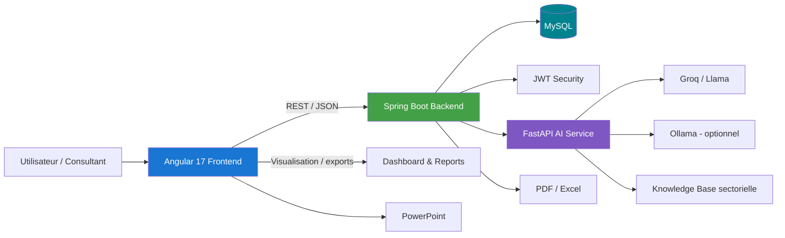

<div align="center">


# IA Benchmark

### Plateforme intelligente d'évaluation de la maturité digitale des entreprises

<p>
  <strong>Évaluer · Comprendre · Comparer · Prioriser · Transformer</strong>
</p>

<p>
  
  
  
  
  
  
  
</p>

<p>
  <a href="#-présentation">Présentation</a> ·
  <a href="#-fonctionnalités">Fonctionnalités</a> ·
  <a href="#-architecture">Architecture</a> ·
  <a href="#-installation">Installation</a> ·
  <a href="#-api-principale">API</a> ·
  <a href="#-roadmap">Roadmap</a>
</p>

</div>

---

## 📌 Présentation

**IA Benchmark** est une plateforme web conçue pour mesurer et améliorer la **maturité digitale des entreprises**.

Elle combine :

- des questionnaires adaptés au **secteur**, au **pays** et au **profil de l'entreprise** ;
- une analyse de maturité basée sur plusieurs **axes et sous-axes** ;
- un service d'IA pour la **génération de questions**, le scoring et les recommandations ;
- un **benchmarking sectoriel** national et international ;
- une feuille de route permettant de transformer les résultats en **actions concrètes** ;
- des rapports exportables pour faciliter l'analyse et la prise de décision.

Le projet est organisé comme une architecture **frontend + backend + microservice IA**, avec une authentification JWT et une base de données MySQL.

---

## 🎯 Objectifs

L'objectif principal est de fournir aux entreprises et aux consultants un outil permettant de :

1. mesurer leur niveau actuel de maturité digitale ;
2. identifier leurs forces et leurs écarts ;
3. comparer leurs performances à des références sectorielles ;
4. obtenir des recommandations personnalisées ;
5. prioriser les actions d'amélioration ;
6. suivre une trajectoire de transformation digitale ;
7. produire des rapports exploitables par les décideurs.

---

## ✨ Fonctionnalités

### 🧠 Évaluation intelligente

- création et gestion des questionnaires ;
- génération de questions assistée par IA ;
- questions adaptées au secteur et au pays ;
- options de réponses contextualisées ;
- pondération des questions ;
- calcul du score global et des scores par axe ;
- identification des gaps critiques ;
- niveau de maturité et explication du résultat.

### 📊 Benchmarking

- comparaison avec une moyenne sectorielle ;
- comparaison avec un top quartile ;
- positionnement percentile ;
- comparaison par axe et sous-axe ;
- tendances et évolutions ;
- identification de leaders ;
- analyse des écarts ;
- roadmap d'amélioration.

### 🤖 Intelligence artificielle

Le microservice IA expose plusieurs capacités :

- génération de questionnaires ;
- scoring intelligent ;
- génération de recommandations ;
- benchmarking ;
- génération/régénération des options de réponses ;
- utilisation de connaissances sectorielles ;
- prise en compte de frameworks et bonnes pratiques.

Le service peut utiliser **Groq/Llama** comme moteur principal et prévoir un fonctionnement local via **Ollama** selon la configuration.

### 🗺️ Plan d'action

- génération automatique d'un plan d'action ;
- priorisation des tâches ;
- suivi des tâches ;
- mise à jour du statut ;
- export du plan ;
- envoi du plan par e-mail.

### 📄 Rapports

- rapport PDF ;
- export Excel ;
- génération de présentations PowerPoint côté frontend ;
- rapport consultant ;
- vue détaillée des scores ;
- intégration d'un espace Power BI dans l'application.

### 👥 Gestion des utilisateurs

- authentification ;
- inscription ;
- récupération et changement de mot de passe ;
- gestion des utilisateurs ;
- gestion des statuts ;
- rôles et accès différenciés ;
- gestion des entreprises.

---

## 🧩 Axes d'analyse

La plateforme manipule notamment les dimensions suivantes :

| Domaine | Exemples |
|---|---|
| 💼 Business | stratégie digitale, innovation, modèle économique, orientation client |
| ⚙️ Processus | automatisation, agilité, cartographie, performance opérationnelle |
| 🔐 SI | cybersécurité, cloud, API, data & analytics |
| 📣 Canaux | expérience client, self-service |
| 📈 Marketing | marketing digital |
| 👥 RH | culture digitale, collaboration, digitalisation RH |
| 🛍️ Offres | offres digitales, plateformes ouvertes |
| 🏢 Modèle opérationnel | gouvernance, innovation, simplification |
| 💾 IT & Data | données, socle IT |

Les connaissances sectorielles sont organisées dans `ai-service/knowledge/sectors/` avec des variantes génériques et sectorielles.

---

## 🏗️ Architecture



### Organisation du repository

```text
pfee/
├── ai-service/                  # Microservice IA FastAPI
│   ├── knowledge/               # Frameworks, benchmarks, réglementations,
│   │                             # bonnes pratiques et données sectorielles
│   ├── services/                # Agents et moteurs IA
│   ├── main.py                  # API FastAPI
│   ├── requirements.txt
│   └── .env.example
│
├── backend3/                    # API Spring Boot
│   ├── src/main/java/com/iabenchmark/
│   │   ├── controller/          # REST controllers
│   │   ├── service/             # Métier
│   │   ├── repository/          # Accès aux données
│   │   ├── model/               # Entités
│   │   ├── dto/                 # DTO
│   │   └── security/            # JWT / sécurité
│   ├── pom.xml
│   └── src/main/resources/
│       └── application.properties.example
│
├── frontend/frontend/            # Application Angular
│   ├── src/app/core/             # modèles, guards, services
│   ├── src/app/features/         # fonctionnalités métier
│   ├── src/assets/               # images et ressources
│   └── package.json
│
├── .gitignore
└── README.md
```

---

## 🛠️ Stack technique

### Frontend

- Angular 17
- TypeScript
- Bootstrap 5
- Font Awesome
- RxJS
- JWT Decode
- PptxGenJS

### Backend

- Java 17
- Spring Boot 3.5
- Spring Web
- Spring Data JPA
- Spring Security
- JWT
- MySQL
- Lombok
- Apache POI
- iText PDF
- Spring Mail

### AI Service

- Python
- FastAPI
- Pydantic
- HTTPX
- python-dotenv
- python-pptx
- Groq / Llama
- Ollama en option

---

## 🔐 Sécurité

La plateforme intègre notamment :

- authentification JWT ;
- Spring Security ;
- gestion des rôles ;
- contrôle d'accès aux ressources d'entreprise ;
- validation des données côté backend ;
- séparation des secrets via variables de configuration.

> ⚠️ Les fichiers `.env` et les vraies clés/secrets ne doivent jamais être commités dans Git.

---

## 🚀 Installation

### 1. Prérequis

Installer :

- Java 17+
- Maven 3.9+
- Node.js 18+ recommandé
- npm
- Python 3.10+
- MySQL 8+
- Git

Pour les fonctionnalités IA avec Groq :

- une clé API Groq.

Pour une exécution IA locale :

- Ollama installé et configuré.

---

### 2. Cloner le projet

```bash
git clone https://github.com/Mouhameedisleem/pfee.git
cd pfee
```

---

### 3. Configurer MySQL

Créer une base :

```sql
CREATE DATABASE ia_benchmark;
```

Copier :

```text
backend3/src/main/resources/application.properties.example
```

vers :

```text
backend3/src/main/resources/application.properties
```

Puis renseigner au minimum :

```properties
spring.datasource.username=root
spring.datasource.password=YOUR_DB_PASSWORD

jwt.secret=YOUR_JWT_SECRET

ai.service.url=http://localhost:8000
```

Pour l'envoi d'e-mails, renseigner également la configuration SMTP.

---

### 4. Lancer le backend

```bash
cd backend3
./mvnw spring-boot:run
```

Sous Windows :

```bash
mvnw.cmd spring-boot:run
```

Le backend écoute par défaut sur :

```text
http://localhost:8080
```

---

### 5. Configurer et lancer le service IA

```bash
cd ai-service
python -m venv .venv
```

Activer l'environnement virtuel.

Linux/macOS :

```bash
source .venv/bin/activate
```

Windows :

```bash
.venv\Scripts\activate
```

Installer les dépendances :

```bash
pip install -r requirements.txt
```

Créer `.env` à partir de `.env.example` puis renseigner :

```env
GROQ_API_KEY=your-groq-api-key
GROQ_MODEL=llama-3.3-70b-versatile
AI_SERVICE_PORT=8000
```

Lancer :

```bash
python main.py
```

Le service IA sera disponible sur :

```text
http://localhost:8000
```

Documentation FastAPI :

```text
http://localhost:8000/docs
```

---

### 6. Lancer le frontend

```bash
cd frontend/frontend
npm install
npm start
```

L'application Angular sera disponible sur :

```text
http://localhost:4200
```

---

## 🔌 API principale

### Authentification

```text
POST /api/auth/login
POST /api/auth/register
POST /api/auth/register-consultant
POST /api/auth/register-company
GET  /api/auth/me
POST /api/auth/forgot-password
POST /api/auth/reset-password
POST /api/auth/change-password
```

### Entreprises

```text
GET    /api/companies
GET    /api/companies/{id}
POST   /api/companies
PUT    /api/companies/{id}
DELETE /api/companies/{id}
GET    /api/companies/{id}/ai-questions
GET    /api/companies/{id}/sector-questions
POST   /api/companies/{id}/finalize
```

### Évaluations

```text
POST /api/evaluations
GET  /api/evaluations/{id}
GET  /api/evaluations
GET  /api/evaluations/latest
GET  /api/evaluations/dashboard
GET  /api/evaluations/{id}/recommendations
GET  /api/evaluations/{id}/benchmark
POST /api/evaluations/{id}/regenerate
POST /api/evaluations/{id}/regenerate-benchmark
POST /api/evaluations/{id}/validate
GET  /api/evaluations/{id}/report/pdf
```

### Plans d'action

```text
POST   /api/action-plans/generate/{evaluationId}
GET    /api/action-plans/{evaluationId}
PUT    /api/action-plans/task/{id}
DELETE /api/action-plans/task/{id}
POST   /api/action-plans/{evaluationId}/send
GET    /api/action-plans/{evaluationId}/export
```

### Service IA

```text
GET  /health
GET  /api/ai/frameworks
POST /api/ai/generate-questionnaire
POST /api/ai/generate-options
POST /api/ai/score
POST /api/ai/generate-recommendations
POST /api/ai/benchmark
```

---

## 📸 Aperçu

### Écran de connexion


### Benchmarking


### Présentation de la plateforme


> D'autres captures du dashboard, des questionnaires, du scoring et des rapports peuvent être ajoutées dans `docs/screenshots/`.

---

## 🧪 Tests et qualité

Le frontend contient une configuration de tests Angular/Jasmine/Karma.

Le backend utilise Spring Boot Test et Spring Security Test.

Avant une release, il est recommandé d'exécuter :

```bash
# Frontend
cd frontend/frontend
npm test

# Backend
cd backend3
./mvnw test
```

---

## 📈 Roadmap

### Version actuelle

- [x] Authentification et gestion des utilisateurs
- [x] Gestion des entreprises
- [x] Questionnaires
- [x] Génération IA
- [x] Scoring de maturité
- [x] Benchmarking
- [x] Recommandations
- [x] Plans d'action
- [x] Rapports PDF / Excel
- [x] Service IA indépendant

### Prochaines améliorations

- [ ] Docker Compose pour lancer toute la plateforme
- [ ] CI/CD GitHub Actions
- [ ] Tests unitaires et d'intégration renforcés
- [ ] Documentation OpenAPI complète
- [ ] Observabilité et logs centralisés
- [ ] Gestion avancée des versions d'évaluation
- [ ] Historique de maturité dans le temps
- [ ] Dashboard exécutif enrichi
- [ ] Système de notifications
- [ ] Déploiement cloud
- [ ] Documentation technique complète

---

## 🤝 Contribution

Les contributions sont les bienvenues.

1. Forker le projet.
2. Créer une branche :

```bash
git checkout -b feature/ma-fonctionnalite
```

3. Effectuer les modifications.
4. Ajouter ou mettre à jour les tests.
5. Committer :

```bash
git commit -m "feat: ajout de ma fonctionnalite"
```

6. Pousser la branche :

```bash
git push origin feature/ma-fonctionnalite
```

7. Ouvrir une Pull Request.

---

## 📚 Contexte académique

Ce repository contient un projet de **PFE (Projet de Fin d'Études)** orienté :

- transformation digitale ;
- intelligence artificielle ;
- évaluation de maturité ;
- benchmarking ;
- systèmes d'information ;
- développement full-stack.

L'objectif est de mettre à disposition une plateforme exploitable par des entreprises, consultants et décideurs afin de transformer une évaluation digitale en **plan d'amélioration concret et mesurable**.

---

## 👨‍💻 Auteur

**Mouhameed Isleem**

GitHub :  
https://github.com/Mouhameedisleem

---

## 📄 Licence

Aucune licence open source n'est actuellement déclarée dans le repository.

Si le projet doit être distribué publiquement, il est recommandé de choisir et d'ajouter explicitement une licence adaptée au contexte du PFE.

---

<div align="center">

### 🚀 IA Benchmark
**Measure your digital maturity. Understand your gaps. Build your roadmap.**

</div>
